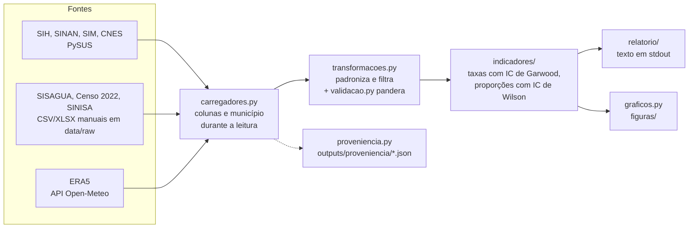

# Agravos relacionados à água e qualidade da água em Parauapebas (PA) — PET-Saúde CLIMA, Eixo II

[](https://github.com/rosivjr/pet-saude-clima/actions/workflows/ci.yml?query=branch%3Amaster)

Análise descritiva e ecológica, com dados públicos do SUS e de saneamento,
das doenças relacionadas a saneamento ambiental inadequado (DRSAI) e da
qualidade da água para consumo humano em Parauapebas (PA). Projeto do GAT 2
(Eixo II), UEPA Campus Parauapebas e SEMSA. Estado: em desenvolvimento; os
números de 2025 e 2026 são preliminares.

## A pergunta e por que ela importa aqui

Qual foi, entre 01/01/2023 e 30/06/2026, a ocorrência de DRSAI entre os
residentes de Parauapebas, e qual foi a qualidade da água medida pela
vigilância no mesmo período e no mesmo território?

Parauapebas cresceu rápido por causa da mineração (Souza, 2024), e esse
crescimento formou periferias sem rede de esgoto e com abastecimento de água
desigual. Diarreias, hepatite A, leptospirose e parasitoses são classificadas
pela FUNASA (2010) como relacionadas a essas condições. Descrever onde e
quando os agravos e a água fora do padrão aparecem dá à vigilância municipal
um ponto de partida para priorizar áreas e meses.

## O que o desenho permite e não permite concluir

É um estudo **ecológico e descritivo**, com o município (e, na água, a área
de abrangência) como unidade de análise.

**Permite:** descrever taxas de internação e de notificação por grupo de
agravo, idade, sexo e mês; descrever o percentual de amostras de água fora do
padrão da Portaria GM/MS nº 888/2021 por parâmetro, área e mês; mostrar
coincidências no tempo e no território, como hipóteses para a gestão local.

**Não permite:** atribuir os agravos à água; tirar conclusão sobre quem foi
internado ou notificado (seria falácia ecológica; Morgenstern, 1995); estimar
associação ou efeito, porque o plano de análise não inclui modelo de
regressão. As bases de rotina medem uso de serviço e notificação, não a
ocorrência real da doença: o SIH só cobre o SUS, o SINAN só capta quem foi
notificado, e os últimos meses crescem com o atraso de faturamento.

## Por que saúde, água e clima são cruzados, e por qual chave

Os grupos de DRSAI (FUNASA, 2010, a partir de Cairncross e Feachem, 1993) são
definidos pela via de transmissão ambiental: feco-oral, inseto vetor, contato
com a água, higiene e geo-helmintos. A água consumida e a chuva são as
condições ambientais dessas vias, e por isso aparecem ao lado dos agravos.

**A chave do cruzamento é município de residência × mês.** As bases de saúde
(SIH, SINAN, SIM) e as de ambiente (SISAGUA, ERA5) nunca são ligadas por
pessoa: elas só se encontram no mesmo mês e no mesmo município, como séries
agregadas lado a lado. A única ligação entre registros ocorre dentro do
SISAGUA: cada amostra se liga ao cadastro da solução de abastecimento por
`NU_SOLUCAO_ABASTECIMENTO`, no ano da coleta ou, sem cadastro nesse ano, no
anterior mais próximo e depois no seguinte (decisão 0005).

## Pipeline



`main.py` orquestra o fluxo. Cada módulo tem uma responsabilidade e só passa
DataFrames e dataclasses ao seguinte.

## Fontes

Detalhes de cada base (variáveis, unidades, códigos de ausente e tratamento)
em [`docs/dados.md`](docs/dados.md).

<!-- fontes:inicio -->
| Fonte | Conteúdo | Período | Obtenção | Extração |
|---|---|---|---|---|
| SIH/SUS | Internações, AIH reduzida, tipo 1 | competências 2023-01 a 2026-07; da 2026-07 só entram internações com `DT_INTER` até 30/06/2026, fim da análise | PySUS | 09/09/2026 a 18/10/2026 |
| SINAN | 7 agravos de notificação compulsória | 2023 a 2026 | PySUS | 09/09/2026 a 20/10/2026 |
| SINAN hepatites | Hepatite A (análise à parte, `sinan/`) | 2022 e 2023 | PySUS | HEPABR22: 20/10/2026; HEPABR23: 26/09/2026 |
| SIM | Óbitos por causa básica | 2023 e 2024 (2025 e 2026 não publicados) | PySUS | 25/09/2026 |
| CNES | Estabelecimentos, competência de junho | 2023 a 2026 | PySUS | 16/09/2026 a 20/10/2026 |
| SISAGUA | Vigilância da qualidade da água e cadastro do abastecimento | 2023 a 2026 | CSV manual, dados abertos do MS | 04/09/2026 a 18/09/2026 |
| Censo 2022 | Água, esgoto e lixo dos domicílios (SIDRA 6803, 6805, 6892) | 2022 | CSV manual, SIDRA | 25/09/2026 |
| SINISA | Indicadores de água e esgoto | ano de referência 2024 | XLSX manual, Min. das Cidades | 25/09/2026 |
| IBGE | Estimativas de população; 2023 interpolada (decisão 0016) | 2023 a 2026 | valores em `config.py` | — |
| ERA5 | Precipitação diária, reanálise, grade de 0,25° | 2023 a 2026 | API do Open-Meteo | 25/09/2026 |
<!-- fontes:fim -->

Os dados de 2025 e 2026 do SIH e do SINAN são preliminares e mudam a cada
atualização do DATASUS. Cada execução grava em `outputs/proveniencia/` o
nome, a data, o tamanho e o SHA-256 de cada arquivo lido; duas execuções com
resultados diferentes podem ser comparadas por esses arquivos.

### Arquivos a baixar manualmente

Salvar em `data/raw/` com estes nomes:

- `sisagua_2023.csv` a `sisagua_2026.csv` e `sisagua_populacao.csv`
  (dadosabertos.saude.gov.br, dataset "SISAGUA - Vigilância Parâmetros Básicos";
  SHA-256 da versão usada na decisão 0017);
- `censo2022_6803_agua.csv`, `censo2022_6805_esgoto.csv`, `censo2022_6892_lixo.csv`
  (SIDRA: município Parauapebas, todas as categorias, formato CSV);
- `sinisa/indicadores_de_abastecimento_de_agua.xlsx` e
  `sinisa/indicadores_de_esgotamento_sanitário.xlsx`.

Censo e SINISA ausentes não interrompem a execução: a seção fica marcada como
indisponível. SISAGUA ausente interrompe, porque é a base do perfil sanitário.

## Como rodar

Requisitos: Python 3.12 ou mais novo e [uv](https://docs.astral.sh/uv/)
(testado com uv 0.13.1, Linux). As versões exatas dos pacotes estão em
`uv.lock`. A memória limite considerada é de 24 GB: os arquivos nacionais
são lidos em blocos, só com as colunas e o município necessários.

```bash
uv sync --locked                       # instala as versões do uv.lock
uv run pytest                          # testes com dados sintéticos
uv run ruff check .                    # lint
uv run python main.py > relatorio.txt  # relatório em stdout, log em stderr
```

A primeira execução baixa SIH, SIM, SINAN, CNES e a série de chuva. O PySUS
guarda os arquivos em cache em `~/pysus`; a chuva fica em `data/raw/clima/`.
O `Makefile` tem atalhos (`make testes`, `make lint`, `make relatorio`) e os
alvos das análises à parte (`make dda`, `make sih`, `make sinan`).

**Saídas:** `relatorio.txt` (relatório em texto, com qualidade dos dados e
sensibilidade sem o ano parcial), `outputs/proveniencia/` e `figuras/`.

As regras do projeto (arquitetura, critérios, dados e estatística) e o fluxo
de contribuição estão em [`CONTRIBUTING.md`](CONTRIBUTING.md).

## Exemplo de resultado


Percentual de amostras de água fora do padrão da Portaria GM/MS nº 888/2021
(cloro, turbidez e pH) ou com presença (coliformes totais e *E. coli*), por
parâmetro, com IC 95% de Wilson e o número de amostras. A unidade é a
amostra de água, não a pessoa. Fonte: SISAGUA. A figura é gerada por
`graficos.grafico_conformidade_agua` e copiada de `figuras/01_conformidade_agua.png`.

## Mapa de pastas

```
src/
  config.py          única fonte de constantes: município, período, população, CID, limites
  carregadores.py    acesso às fontes, sem filtrar conteúdo
  transformacoes.py  padronização e filtros (idade, período, tipo de AIH, RESULTADO)
  validacao.py       esquemas pandera: a execução para se uma base mudar de formato
  estatistica.py     pessoa-tempo, IC de Garwood e de Wilson, razão de taxas
  indicadores/       cálculos, um submódulo por assunto
  relatorio/         formatação do relatório em texto
  graficos.py        figuras a partir de resultados já calculados
  qualidade.py       completitude, consistência e duplicidade
  proveniencia.py    registro de cada arquivo lido em cada execução
tests/               testes com dados sintéticos e valores calculados à mão
main.py              orquestra o fluxo
dda/, sih/, sinan/   análises à parte: Sivep-DDA, SIH nacional e hepatite A;
                     sih/figuras_sih.py faz as figuras de saneamento (SINISA) e de
                     internações por diarreia (SIH nacional)
exploracao/          notas de exploração das bases
docs/
  metodos.md         plano de análise, na ordem do STROBE/RECORD
  strobe_record.md   onde cada item do STROBE/RECORD está atendido
  dados.md           descrição de cada base
  decisoes/          um registro por decisão metodológica
  referencias.md     referências conferidas
  seguranca.md       modelagem de ameaças
  img/               figura de exemplo do README
data/                raw/, interim/, processed/ (fora do git)
outputs/, figuras/   saídas da execução (fora do git)
```

## Decisões metodológicas

Cada decisão tem um registro em [`docs/decisoes/`](docs/decisoes/) com
contexto, alternativas e consequências. Um registro aceito só recebe correções
de redação e remissões; mudança de regra gera registro novo.

| Decisão | Regra | Fonte |
|---|---|---|
| [0001](docs/decisoes/0001-sinan-so-confirmados.md) | No SINAN, caso é a notificação confirmada; notificados, descartados e sem classificação aparecem ao lado | Fichas e dicionários do SINAN (`CLASSI_FIN`); RECORD 6.1 |
| [0002](docs/decisoes/0002-pessoa-tempo-em-ano-parcial.md) | Ano incompleto entra no denominador como pessoa-tempo | Rothman, Greenland e Lash (2008) |
| [0003](docs/decisoes/0003-recorte-sih-por-dt-inter.md) | A internação entra no período pela data de internação, não pela competência | Bittencourt, Camacho e Leal (2006); notas técnicas do SIH |
| [0004](docs/decisoes/0004-cid-tres-caracteres-grupo-unico.md) | CID comparado pelos 3 primeiros caracteres; um grupo por internação, pelo diagnóstico principal | FUNASA (2010); Cairncross e Feachem (1993); RECORD 7.1 |
| [0005](docs/decisoes/0005-ligacao-amostra-cadastro-por-ano.md) | Amostra ligada ao cadastro da solução no ano da coleta; se faltar, no anterior e depois no seguinte | SISAGUA; RECORD 6.3 e 12.3 |
| [0006](docs/decisoes/0006-comparacao-entre-anos.md) | Taxa anualizada por ano e sensibilidade sem o ano parcial (substituída em parte pela 0008) | Rothman, Greenland e Lash (2008) |
| [0007](docs/decisoes/0007-padronizacao-direta-por-idade.md) | Comparação com o Pará por padronização direta por idade (rejeitada para o relatório principal, que não compara taxas entre locais) | IBGE, SIDRA 9514; Fay e Feuer (1997) |
| [0008](docs/decisoes/0008-volta-dos-meses-comuns.md) | Comparação entre anos só nos meses comuns a todos, com razão de taxas contra o primeiro ano | Bittencourt, Camacho e Leal (2006) |
| [0009](docs/decisoes/0009-sih-so-aih-tipo-1.md) | Só a AIH do tipo 1 conta como internação; a do tipo 5 contaria duas vezes | Bittencourt, Camacho e Leal (2006), p. 26 |
| [0010](docs/decisoes/0010-ponto-no-resultado-do-sisagua.md) | Ponto no `RESULTADO` do SISAGUA só como milhar com vírgula decimal; outro ponto para a leitura | Portaria GM/MS nº 888/2021 |
| [0013](docs/decisoes/0013-resultado-do-sisagua-em-duas-colunas.md) | `RESULTADO` separado em coluna numérica e coluna de texto | Portaria GM/MS nº 888/2021 |
| [0014](docs/decisoes/0014-analise-territorial-por-area-sem-coordenadas.md) | Análise territorial da água pela área de abrangência, sem coordenadas | Meta 1 do Eixo II |
| [0016](docs/decisoes/0016-fonte-da-populacao.md) | População do IBGE de cada ano; 2023 por interpolação geométrica | IBGE, Censo 2022 e estimativas 2024–2026 |
| [0017](docs/decisoes/0017-sisagua-por-csv-manual.md) | SISAGUA baixado à mão em CSV, não pelo PySUS | Portal de Dados Abertos do MS; RECORD 12.1 |
| [0018](docs/decisoes/0018-limiar-de-eventos-para-taxas.md) | Taxa ou grupo com menos de 10 eventos leva o aviso de estimativa instável | NCHS, Vital Health Stat 2(200), 2023 |
| [0019](docs/decisoes/0019-sih-de-todas-as-ufs.md) | Proposta: ler o SIH de todas as UFs, para contar residentes internados fora do Pará (hoje, limitação de 1,1% a 1,5%) | Notas técnicas do SIH |
| [0020](docs/decisoes/0020-limiar-de-amostras-para-proporcoes.md) | Proporção de amostras de água com menos de 30 amostras é marcada | NCHS, Vital Health Stat 2(175), 2017 |
| [0021](docs/decisoes/0021-limpeza-das-unidades-do-sivep-dda.md) | Número de unidades do Sivep-DDA acima de 100 vezes a mediana do município é erro de digitação (critério do projeto) | Sensibilidade de 10 a 1000× em `dda/` |

Os números 0011, 0012 e 0015 foram reservados e não viraram arquivo; essas
decisões estão explicadas em comentários no código: formato do código do
município (config.py, junto de MUNICIPIO_IBGE_6), leitura do SISAGUA em blocos
(carregadores.py, docstring de _ler_csv_filtrado) e escala symlog no gráfico
de hospitais (graficos.py).

Outras regras: limites de água da Portaria GM/MS nº 888/2021; plano de
amostragem pela Diretriz Nacional do Vigiagua (MS, 2016); completitude pela
escala de Romero e Cunha (2006). O plano completo está em
[`docs/metodos.md`](docs/metodos.md).

## Pendências

- Resposta da SEMSA: regra de arredondamento do plano de amostragem e dados
  agregados do Sivep-DDA.
- Conferir na fonte original: códigos de geo-helmintos e teníases (FUNASA),
  `COD_IDADE` do SIH, códigos de ignorado do SINAN, `CLASSI_FIN` da zika.
- Dengue fora do pipeline: o arquivo nacional do SINAN só pode entrar lido com
  as colunas e o município necessários.
- Conferir no SISAGUA de 2023 e 2024 se as coordenadas também vêm vazias e se
  as amostras também são todas de SAC (decisão 0014); rever o denominador dos
  microbiológicos (decisão 0013).
- Lacunas que dependem de outras bases: internações por bairro, atendimentos
  ambulatoriais e rotavírus.

## Ética

O projeto usa só dados públicos e anonimizados, e nenhum script imprime
registro individual. Como o pipeline lê microdados do SIH e do SINAN, e não só
dados agregados, **a consulta ao CEP está em andamento**.

Base provável de dispensa: Res. CNS 510/2016, art. 1º, parágrafo único,
incisos II, III e V. A confirmação com a coordenação e o CEP está pendente. O
número do parecer ou da dispensa entra aqui quando sair.

## Uso de inteligência artificial

Ferramentas de inteligência artificial generativa foram usadas como apoio
na escrita de parte do código, dos testes e da documentação. O autor revisou
cada alteração e responde pelo conteúdo. Nenhum dado ou resultado foi gerado
por essas ferramentas: todos os números saem das fontes listadas acima, pelo
pipeline, e cada referência foi conferida na fonte original.

## Como citar

Os metadados estão em [`CITATION.cff`](CITATION.cff). Em ABNT:

SOARES, R. *Agravos relacionados à água e qualidade da água em Parauapebas
(PA)*: PET-Saúde CLIMA, Eixo II. 2026. Código-fonte.

O repositório é público e foi publicado sem o histórico do repositório
privado anterior (`docs/seguranca.md`). O DOI do Zenodo entra aqui na
primeira versão arquivada.

## Licença

Código sob a licença MIT; documentação e figuras sob CC BY 4.0. Texto
completo em [`LICENSE`](LICENSE). Os dados brutos não fazem parte do
repositório e seguem as condições de cada fonte.

## Financiamento

Projeto submetido ao edital SGTES/MS nº 23/2026, do Programa de Educação pelo
Trabalho para a Saúde (PET-Saúde) do Ministério da Saúde.

## Referências citadas

CAIRNCROSS, S.; FEACHEM, R. *Environmental health engineering in the tropics*.
2. ed. Chichester: John Wiley & Sons, 1993.

FUNDAÇÃO NACIONAL DE SAÚDE (FUNASA). *Impactos na saúde e no Sistema Único de
Saúde decorrentes de agravos relacionados a um saneamento ambiental
inadequado*. Brasília: Funasa, 2010.

MORGENSTERN, H. Ecologic studies in epidemiology: concepts, principles, and
methods. *Annual Review of Public Health*, v. 16, p. 61-81, 1995.

SOUZA, M. K. M. S. *A urbanização de Parauapebas/PA*: a cidade produzida pela
mineração. 2024. Tese (Doutorado em Geografia) – Universidade Federal da
Paraíba, João Pessoa, 2024. Disponível em:
https://repositorio.ufpb.br/jspui/handle/123456789/34639.
